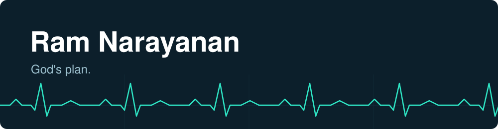

  

B.Tech graduate in AI & ML (Sri Ramachandra University, 2026), now studying for an MBA in GenAI & Product Management at IIT Patna. I work across NLP, computer vision and MLOps, and I like taking a model all the way from training to something other people can use.

Right now I'm a Python developer intern at CodeCrave Solutions, working on evaluation pipelines for AI code-review agents and on enterprise data pipelines in Palantir Foundry. Before that I helped build ZERO-AI, a business intelligence platform, at Zero4genz, built medical imaging and recommendation systems during my ML internship at Nexvia, and built ADR-NET, a clinical-text model behind a 2026 IEEE conference paper.

## Tools

